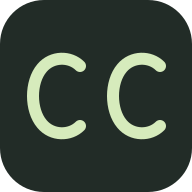
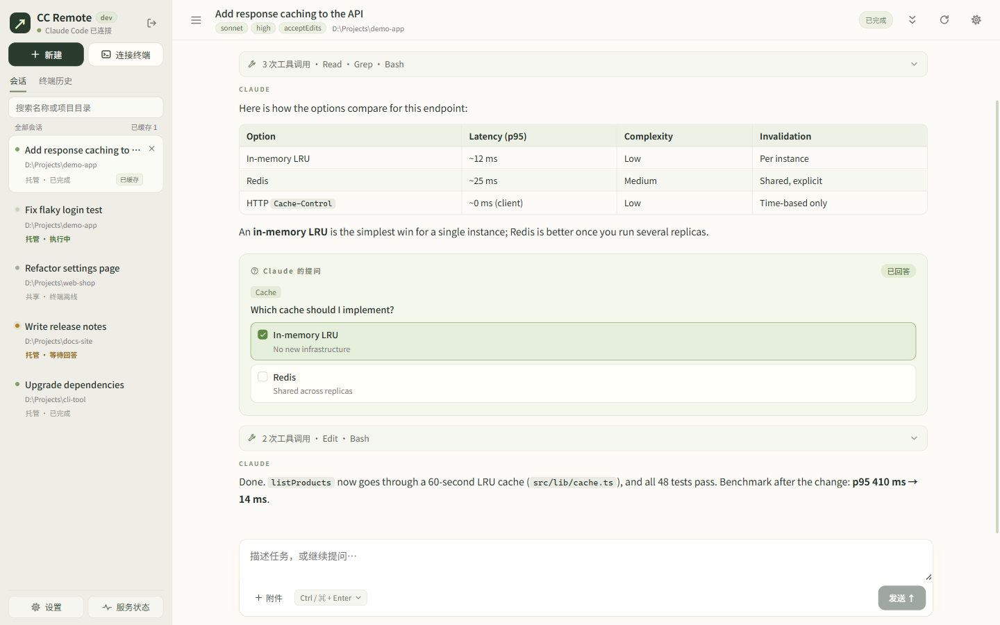

<p align="center"></p>

<h1 align="center">CC Remote</h1>

<p align="center"><strong>Step away from your desk. Keep your coding session going.</strong></p>

<p align="center">Run Claude Code and Codex on your own computer. Manage tasks from a terminal, browser, phone or Windows client.</p>

<p align="center">
  <a href="https://github.com/huanfeng/cc-remote/actions/workflows/ci.yml"></a>
  <a href="https://github.com/huanfeng/cc-remote/releases"></a>
  <a href="LICENSE"></a>
</p>

<p align="center">
  <a href="README.md">简体中文</a> · English<br>
  <a href="#quick-start">Quick start</a> · <a href="docs/getting-started.en.md">First-use guide</a> · <a href="https://huanfeng.github.io/cc-remote/about/en/">Project home</a> · <a href="https://huanfeng.github.io/cc-remote/">Open web client</a> · <a href="https://github.com/huanfeng/cc-remote/releases/latest">Downloads</a>
</p>

<p align="center">
  
  &nbsp;
  
</p>
<p align="center"><sub>Interface examples; appearance may differ in the current release.</sub></p>

## Take the task with you. Keep it running on your computer.

Run `ccr` in a project to start a Claude Code session. Press `Ctrl+]` when you leave: the task keeps running on the host. Check progress, answer approvals or send another message from your phone, then reconnect with `ccr` when you return.

You can also start Claude Code or Codex managed sessions directly in the web or desktop client. Choose a project, send a task and work across several sessions. Closing the browser does not stop background tasks.

- **Continue away from your desk**: read replies, tool activity and files; answer approvals, questions and plan confirmations. Install the mobile web UI as a PWA.
- **Manage projects and hosts together**: browse sessions by project, find active work first and switch between your computers.
- **Keep familiar workflows**: Claude Code supports native terminal/web handoff; Codex supports managed sessions and local history import.
- **See accounts and quotas together**: read CC-Switch profiles, select or switch Claude suppliers, and compare subscription readings, reset times and history across accounts.
- **Check usage from the Windows tray**: hover for the native usage panel and click to open the client. Compare account quotas without opening the main window.

The backend is a self-hosted executable. Sessions run on your host, using its CLI configuration and session settings for models, accounts and permissions. Model requests still go to the configured provider.

## Choose your starting point

| What you want | Where to start |
| --- | --- |
| A Windows client with a usage tray | Use the **Windows full installer** below; x64 only |
| A host on Linux, macOS or Windows ARM64 | Install the backend and use its built-in web UI |
| Continue tasks from your phone | Install a host first, then follow the [phone connection guide](docs/getting-started.en.md#connect-a-phone-or-another-computer) |
| One web client for several hosts | [Open the public web client](https://huanfeng.github.io/cc-remote/) after checking the [connection requirements](docs/standalone.md) (Chinese) |

> The web client needs your own running host. The public page provides neither cloud execution nor a preconfigured account. The default host address accepts local connections only.

## Quick start

### 1. Prepare your local CLI

Install and sign in to [Claude Code](https://code.claude.com/docs) or [Codex CLI](https://developers.openai.com/codex/cli) under **the same system account that runs the host**. You only need the CLI you intend to use.

```sh
claude auth login  # for Claude Code
codex login        # for Codex
```

### 2. Install CC Remote

**Windows x64: backend + desktop client + built-in tray** (PowerShell 5.1 / 7):

```powershell
irm https://github.com/huanfeng/cc-remote/releases/latest/download/install-desktop.ps1 | iex
```

**Linux / macOS: backend + web UI**:

```sh
curl -fsSL https://github.com/huanfeng/cc-remote/releases/latest/download/install.sh | sh
```

<details>
<summary>Windows backend only (x64 / ARM64)</summary>

```powershell
irm https://github.com/huanfeng/cc-remote/releases/latest/download/install.ps1 | iex
```

</details>

The installer downloads the latest stable release, verifies SHA256, registers and starts a service for your current user, and creates the `ccr` command. Open a new terminal if `ccr` is not found after installation.

### 3. Start your first task

**Windows client**: click the tray icon or launch **CC Remote** from the Start menu, then connect through **Local service**.

**Browser**: open <http://127.0.0.1:8787> and follow the [token instructions](docs/getting-started.en.md#browser-connection-and-access-token) to connect. Click **New**, choose Claude Code or Codex, and select **an existing project directory on the host**.

**Claude Code terminal handoff**: run this in your project:

```sh
cd your-project
ccr
# Ctrl+] detaches while the task continues. Run ccr again to reconnect.
```

Once it works locally, [connect your phone or another computer](docs/getting-started.en.md#connect-a-phone-or-another-computer).

## Supported workflows

| Capability | Claude Code | Codex |
| --- | --- | --- |
| Start managed sessions in the web / desktop client | Yes | Yes |
| Streaming replies, tool activity, approvals and questions | Yes | Yes |
| Import local history and continue it | Yes | Yes |
| `ccr` terminal/web handoff and web terminal view | Yes | Not yet |
| Official subscription readings | Supported official logins / OAuth accounts | Local official login |

The backend supports **Windows, Linux and macOS**. Native client downloads and the graphical hover tray currently target **Windows x64**. Quotas depend on what the provider reports; API-key and third-party profiles may have no subscription readings. See [Codex](docs/codex.md), [subscription monitoring](docs/subscription-monitor.md) and [known limitations](docs/architecture.md#已知限制) (Chinese).

## A few commands for everyday use

`ccr` and `cc-remote` are interchangeable. Examples use the shorter name:

```sh
ccr                    # pick a session in this project, or create one
ccr ls                 # browse and attach to recent terminal sessions
ccr --resume <id>      # resume a Claude Code session
ccr -c                 # continue this directory's latest Claude Code session
ccr status             # inspect the host service
ccr logs -f            # follow host logs
ccr update             # update the CLI and backend only
```

Lists support arrow keys, numbers plus Enter, `/` to filter, `r` to refresh and `q` / Esc to quit. See [usage](docs/usage.md) (Chinese).

**To update the client and tray**, repeat the Windows full installation command. Configuration, accounts and history are kept. Exit the running client from its tray menu and reopen it to use the new version.

## Find your next step

The first-use guide is available in English; detailed reference docs are currently in Chinese.

| I want to… | Read |
| --- | --- |
| Go from installation to my first task | [First-use guide](docs/getting-started.en.md) |
| Find my token, connect a phone or troubleshoot | [Connection guide](docs/getting-started.en.md#connect-a-phone-or-another-computer) |
| Use sessions, approvals, attachments and file previews | [Usage](docs/usage.md) |
| Use Codex or continue local history | [Codex guide](docs/codex.md) |
| Select / switch CC-Switch supplier profiles | [Supplier profiles](docs/supplier-profiles.md) |
| Compare account quotas and history | [Subscription monitoring](docs/subscription-monitor.md) |
| Use the desktop app, tray and local path menu | [Desktop app](docs/desktop.md) |
| Configure proxies, models, services or listen addresses | [Configuration](docs/configuration.md) |
| Deploy a web client, HTTPS or a reverse proxy | [Standalone frontend](docs/standalone.md) · [Security](docs/security.md) |
| Download manually, update or uninstall | [Releases and installation](docs/release.md) |
| Build, develop or contribute | [Development](docs/development.md) · [Architecture](docs/architecture.md) |

## FAQ

**Can my phone open `127.0.0.1:8787`?** That address points to the phone itself. Use your host computer's LAN address or a configured remote address; see the [connection guide](docs/getting-started.en.md#connect-a-phone-or-another-computer).

**Will a task continue if I close the browser or detach?** Yes, while the host and its session process keep running. `Ctrl+]` detaches; use the session's stop action to interrupt work.

**The CLI works in my terminal but fails in the service.** Services do not load your shell profile, so their CLI paths, accounts or proxy environment may differ. Follow the [troubleshooting steps](docs/getting-started.en.md#if-something-goes-wrong).

> An access token grants code execution on the host. The default listener is local only; LAN HTTP is unencrypted. Use a trusted network or HTTPS for remote access and protect your token. See [security](docs/security.md).

## Contribute

Report problems in [Issues](https://github.com/huanfeng/cc-remote/issues) with the version, operating system, reproduction steps and logs with secrets removed. Suggestions and improvements are welcome; start with the [development guide](docs/development.md).

If CC Remote helps you take work from your desk to your phone, share the project or leave a Star so other Claude Code and Codex users can find it.

[MIT License](LICENSE)
