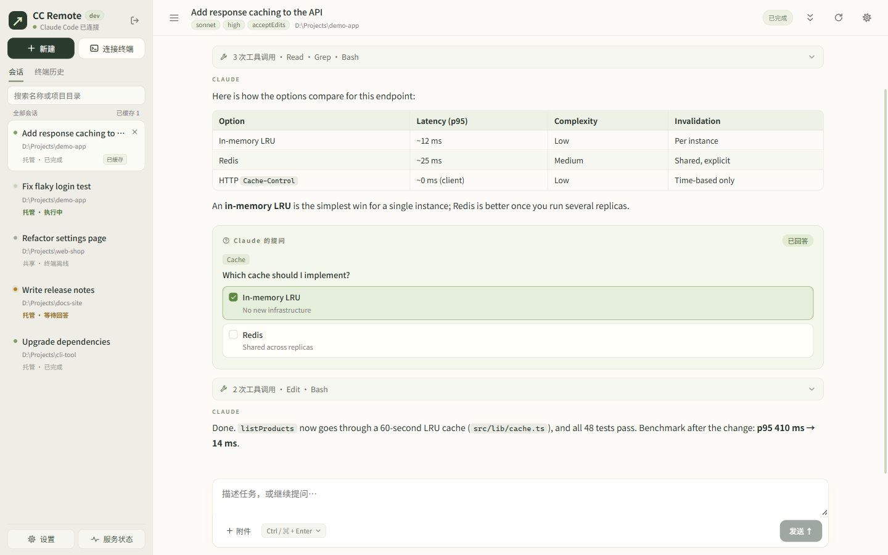
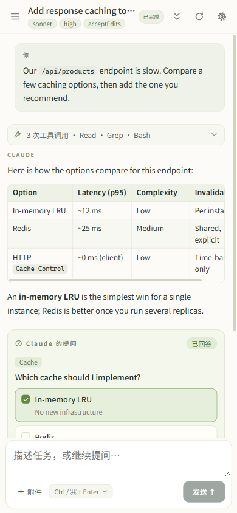

<p align="center"></p>

<h1 align="center">CC Remote</h1>

<p align="center"><strong>在一个网页中管理多台服务器上的 Claude Code、Codex 会话和项目终端。</strong></p>

<p align="center">在浏览器执行宿主命令，在 Web 和命令行切换供应商，使用 Claude 官方 OAuth 订阅账号。</p>

<p align="center">
  <a href="https://github.com/huanfeng/cc-remote/actions/workflows/ci.yml"></a>
  <a href="https://github.com/huanfeng/cc-remote/releases"></a>
  <a href="LICENSE"></a>
</p>

<p align="center">
  简体中文 · <a href="README.en.md">English</a><br>
  <a href="#快速开始">快速开始</a> · <a href="docs/getting-started.md">首次使用指南</a> · <a href="https://huanfeng.github.io/cc-remote/about/">项目主页</a> · <a href="https://huanfeng.github.io/cc-remote/">打开网页客户端</a> · <a href="https://github.com/huanfeng/cc-remote/releases/latest">下载</a>
</p>

<p align="center">
  
  &nbsp;
  
</p>
<p align="center"><sub>界面示例；实际样式以当前版本为准。</sub></p>

## 主要功能

### 1. 用 Web 管理多台服务器的会话

把家里的电脑、工作站或远程服务器添加到同一个网页，在服务器之间切换、按项目浏览会话。可以新建 Claude Code 会话、继续已有对话、查看流式回复和工具过程，并处理审批与提问；手机浏览器也能使用。

每台服务器分别运行 CC Remote 后台，会话在对应服务器上执行，关闭网页不会停止后台任务。远程访问前，需要先配置好**可达的网络地址、HTTPS 和访问令牌**；使用独立网页连接多台服务器时，还需要允许该网页的来源。

连接方式见[首次使用指南](docs/getting-started.md#用手机或另一台电脑连接)，多服务器与 HTTPS 配置见[独立网页前端](docs/standalone.md)。

### 2. 在浏览器和命令行共用项目 Shell

从会话标题栏或侧栏项目组打开「项目终端」，直接在宿主上运行命令。同一宿主和项目的会话共用一个默认 Shell，也可以用 `ccr shell` 接入同一个进程。收起面板或断线时 Shell 继续运行，重新打开可接回。

桌面布局支持拖动、调整大小和保存位置。桌面应用默认按 `Alt+F` 开合，浏览器默认用 Ctrl 加反引号，重新展开时保留清屏状态和滚动位置。需要执行单条命令时，可以用 `ccr run -- git status --short`。[项目终端使用说明](docs/usage.md#项目终端)

### 3. 在 Web 和命令行切换供应商

可在 CC Remote 中配置 Claude Code / Codex 的 API 供应商，也可使用宿主上的 **CC-Switch** 配置。两端共用新会话的默认供应商。

- **Web / 桌面客户端**：新建会话时选择供应商，也可从已有会话的标题栏切换。切换会恢复原会话及其历史，忙碌时会先确认是否中断。
- **命令行**：用 `ccr --new` 创建 Claude Code 会话，或用 `ccr -r <会话ID>` 恢复会话时选择供应商。脚本可用 `--profile <供应商ID>` 直接指定。

配置与使用方式见[供应商选择与切换](docs/supplier-profiles.md)。

### 4. 使用 Claude 官方 OAuth 模式

用 `claude setup-token` 获取令牌，在「设置 → 供应商 → Claude 官方 OAuth」中添加一个或多个订阅账号。Web 的供应商选择器和 `ccr` 都能选择已保存的账号，也可用 `--profile oauth:<ID>` 直接指定。令牌保存在对应宿主，会话沿用宿主的模型、插件、Hooks、MCP 和权限设置。

查看各账号的 **5 小时 / 每周订阅额度、重置时间与用量历史**，了解哪些账号还有可用额度。后台定期采集，关闭网页或客户端后仍会继续；Windows 托盘也能直接查看账号额度。

添加方法见[OAuth 令牌配置](docs/supplier-profiles.md#oauth-令牌配置)，额度与历史说明见[订阅用量监控](docs/subscription-monitor.md)。

## 其它使用方式

- **Claude Code 状态栏**：在「设置 → Claude Code」中一键配置，提供简洁、彩色、多行风格，支持类型名简写、分项颜色及配色预设。显示可获取的 Provider、模型、思考强度、上下文用量、会话费用及 5 小时 / 7 天配额；缺失信息自动隐藏，卸载恢复安装前配置。配额窗口以 [Claude Code 官方文档](https://code.claude.com/docs/zh-CN/statusline)为准。
- **终端与网页接力**：在项目里运行 `ccr` 开始 Claude Code 会话，按 `Ctrl+]` 断开后任务继续运行；在网页处理任务，回来再用 `ccr` 接入。
- **Windows 桌面客户端**：通过独立标签页同时连接多台服务器，提供前进、后退、刷新和应用内更新；内置托盘可悬停查看用量。
- **手机与 PWA**：从手机查看进度、回复消息和处理审批，也可将网页安装为 PWA。
- **Codex 会话**：支持新建托管会话、读取本机历史并导入继续，具体范围见下方对照表。

CC Remote 是自托管工具。会话使用服务器上的 CLI 与配置运行，模型请求发往你选择的提供方。

## 先选适合你的入口

| 你想做什么 | 使用方式 |
| --- | --- |
| Windows 客户端和用量托盘 | 下方 **Windows 完整安装**，支持 x64 |
| Linux / macOS 或 Windows ARM64 宿主 | 安装后台，使用它自带的网页 |
| 在手机上接着处理任务 | 先安装宿主，再按[手机连接指南](docs/getting-started.md#用手机或另一台电脑连接)配置网络 |
| 用同一个网页连接多台宿主 | [打开公共网页客户端](https://huanfeng.github.io/cc-remote/)，先阅读[连接要求](docs/standalone.md) |

> 网页客户端需要连接你自己的、正在运行的宿主；公共页面不提供云端计算或预置账号。默认监听地址只允许本机访问。

## 快速开始

### 1. 准备本机 CLI

在**运行宿主的同一个系统账户**下，按需安装并登录 [Claude Code](https://code.claude.com/docs) 或 [Codex CLI](https://developers.openai.com/codex/cli)。只使用其中一个时，安装对应 CLI 即可。

```sh
claude auth login  # 使用 Claude Code
codex login        # 使用 Codex
```

### 2. 安装 CC Remote

**Windows x64：后台 + 桌面客户端 + 内置托盘**（PowerShell 5.1 / 7）：

```powershell
irm https://github.com/huanfeng/cc-remote/releases/latest/download/install-desktop.ps1 | iex
```

**Linux / macOS：后台 + 网页界面**：

```sh
curl -fsSL https://github.com/huanfeng/cc-remote/releases/latest/download/install.sh | sh
```

<details>
<summary>Windows 仅安装后台（x64 / ARM64）</summary>

```powershell
irm https://github.com/huanfeng/cc-remote/releases/latest/download/install.ps1 | iex
```

</details>

安装脚本下载最新正式版、校验 SHA256、注册并启动当前用户的后台服务，同时创建 `ccr` 命令。安装后找不到 `ccr` 时，新开一个终端即可。

### 3. 开始第一个任务

**Windows 客户端**：点击托盘图标或从开始菜单打开 **CC Remote**，在「本机服务」中连接。

**浏览器**：打开 <http://127.0.0.1:8787>，按[首次使用指南](docs/getting-started.md#浏览器连接与访问令牌)读取本机访问令牌并连接。然后点「新建」，选择 Claude Code 或 Codex，以及**宿主上已有的项目目录**。

**Claude Code 终端接力**：在项目目录运行：

```sh
cd your-project
ccr
# Ctrl+] 断开，任务继续运行；再次运行 ccr 接回。
```

本机跑通后，再连接手机：[局域网访问、远程访问与连接排查](docs/getting-started.md#用手机或另一台电脑连接)。

## 支持范围

| 能力 | Claude Code | Codex |
| --- | --- | --- |
| 网页 / 桌面客户端新建托管会话 | 支持 | 支持 |
| 流式回复、工具过程、审批与提问 | 支持 | 支持 |
| 读取本机历史并导入继续 | 支持 | 支持 |
| AI 会话的原生终端与网页接力 | 支持 | 暂不支持 |
| 官方订阅额度 | 支持的官方登录 / OAuth 账号 | 本机官方登录账号 |

后台支持 **Windows、Linux、macOS**；原生客户端发布包和图形化悬停托盘目前提供 **Windows x64**。订阅额度由提供方实际返回，API Key / 第三方配置不保证有订阅读数。更多边界见 [Codex](docs/codex.md)、[订阅监控](docs/subscription-monitor.md)和[已知限制](docs/architecture.md#已知限制)。

## 日常只需几个命令

`ccr` 和 `cc-remote` 是同一个入口，以下用短名称：

```sh
ccr                    # 选择当前项目会话，没有则新建
ccr ls                 # 浏览并接入最近的终端会话
ccr --resume <会话ID>  # 恢复 Claude Code 会话
ccr -c                 # 继续当前目录最近的 Claude Code 会话
ccr shell              # 打开或接入当前项目的 Shell
ccr shell ls           # 列出宿主上的项目 Shell
ccr run -- git status --short # 在宿主执行单条命令
ccr status             # 查看后台状态
ccr logs -f            # 查看后台日志
ccr update             # 仅更新命令行与后台
```

列表支持上下键、编号加回车、`/` 筛选、`r` 刷新和 `q` / Esc 退出。完整用法见[使用说明](docs/usage.md)。

**更新客户端和托盘**：签名正式版会自动检查更新，可从「… → 关于与更新」、设置或托盘中下载安装。也可以重新执行 Windows 完整安装命令；配置、账号与历史会保留。`ccr update` 单独更新命令行与后台。详见[桌面应用](docs/desktop.md)。

## 按你的下一步找文档

| 我想…… | 阅读 |
| --- | --- |
| 从安装到完成第一个任务 | [首次使用指南](docs/getting-started.md) |
| 用手机连接、找到令牌、排查连不上 | [连接与排查](docs/getting-started.md#用手机或另一台电脑连接) |
| 学会会话、审批、附件与文件查看 | [使用说明](docs/usage.md) |
| 使用 Codex 或继续原生历史 | [Codex 指南](docs/codex.md) |
| 保留会话切换供应商、配置官方 OAuth Token | [供应商配置](docs/supplier-profiles.md) |
| 查看多账号额度和历史 | [订阅监控](docs/subscription-monitor.md) |
| 使用桌面客户端、托盘与本机路径菜单 | [桌面应用](docs/desktop.md) |
| 配置代理、模型、服务环境或监听地址 | [配置说明](docs/configuration.md) |
| 部署独立网页、配置 HTTPS 或反向代理 | [独立网页](docs/standalone.md) · [安全说明](docs/security.md) |
| 手动下载、更新或卸载 | [发布与安装](docs/release.md) |
| 从源码构建、开发或贡献 | [开发指南](docs/development.md) · [架构](docs/architecture.md) |

## 常见问题

**手机能直接打开本机的 `127.0.0.1:8787` 吗？** 不能，手机上的 `127.0.0.1` 指向手机自己。请使用宿主电脑的局域网地址或配置好的远程地址，见[连接指南](docs/getting-started.md#用手机或另一台电脑连接)。

**关掉浏览器或断开终端，任务还在吗？** 只要宿主及其会话进程仍在运行，任务就会继续。`Ctrl+]` 是断开终端；停止任务请在会话中使用停止操作。

**终端能用，服务里却报错？** 后台服务不加载 shell 配置，CLI 路径、账号与代理环境可能不同。按[连接与环境排查](docs/getting-started.md#遇到问题时)检查。

> 访问令牌拥有在宿主上执行代码的权限。默认仅监听本机；局域网 HTTP 是明文连接，远程访问请配置可信网络或 HTTPS，并妥善保管令牌。见[安全说明](docs/security.md)。

## 参与项目

使用中遇到问题，请在 [Issues](https://github.com/huanfeng/cc-remote/issues) 提供版本、系统、复现步骤和去除敏感信息的日志；功能建议和改进也欢迎提交。开发前请阅读[开发指南](docs/development.md)。

如果 CC Remote 帮你把任务从工位带到了手机上，欢迎分享项目地址，或点一个 Star，让更多使用 Claude Code / Codex 的人找到它。

[MIT License](LICENSE)
