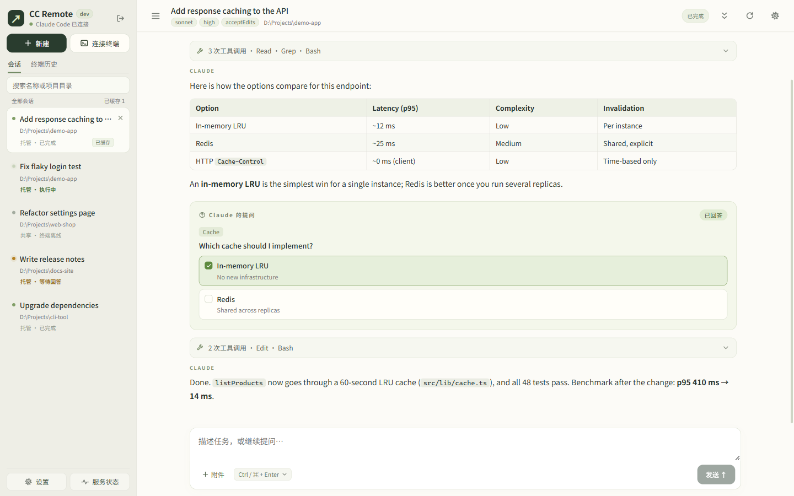
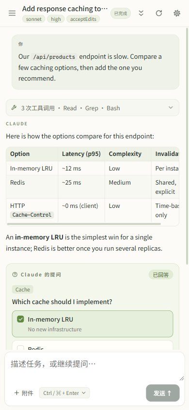

简体中文 | [English](README.en.md)

# CC Remote

在手机或浏览器上使用本机的 Claude Code——终端和网页共享同一个会话，随时接着干。

[](https://github.com/huanfeng/cc-remote/actions/workflows/ci.yml)
[](https://github.com/huanfeng/cc-remote/releases)
[](LICENSE)

<p align="center">
  
  &nbsp;
  
</p>

CC Remote 是一个运行在你电脑上的小型宿主程序（单个可执行文件），直接调用本机已登录的 Claude Code CLI，并提供一个可在手机上使用的 Web 界面（PWA）。不需要终端模拟器，也不需要把代码传到别处。

## 功能特性

- **终端与网页接力**：在项目里运行 `ccr`，宿主持有一个交互式 Claude Code，本地终端接入使用；按 `Ctrl+]` 离开后它继续运行，网页和手机可以接着发消息，再运行 `ccr` 就接回来。子 agent 等长任务不会因为切换而中断。
- **网页托管会话**：直接在网页新建会话、指定项目目录，多个会话并行执行，关掉浏览器任务也不会停。
- **审批、提问、计划都能在网页回答**：工具权限审批、AskUserQuestion 选项、计划确认以卡片呈现；终端会话中网页和终端谁先答谁生效。
- **按会话设置模型与权限模式**：支持全部权限模式（含 `bypassPermissions`，需二次确认）和推理强度，不改动你的 `~/.claude/settings.json`。
- **附件**：粘贴、拖放或选择文件发送给 Claude，图片带缩略图预览。
- **后台服务、开机自启**：一条命令注册为当前用户的系统服务（Windows 计划任务 / systemd / launchd），附带 `ccr` 快捷命令。
- **状态与用量统计**：服务状态面板显示运行情况、费用、tokens、近 14 天趋势和日志。
- **为手机设计**：响应式布局、抽屉式会话列表，可安装为 PWA。
- **多台宿主**：每台宿主自带网页；也可以单独部署一个静态网页前端，在其中添加、切换多台宿主（见[独立网页前端](docs/configuration.md#独立网页前端)）。
- **刷新不丢状态**：当前会话、未发送的草稿和附件、未提交的回答在刷新后自动恢复。

## 快速开始

**前提**：已安装 [Claude Code](https://code.claude.com/docs) 并完成登录（`claude auth login`）；系统为 Windows、Linux 或 macOS。

### 1. 安装

Windows（PowerShell）：

```powershell
irm https://github.com/huanfeng/cc-remote/releases/latest/download/install.ps1 | iex
```

Linux / macOS：

```sh
curl -fsSL https://github.com/huanfeng/cc-remote/releases/latest/download/install.sh | sh
```

脚本会下载最新正式版、校验 sha256、注册并启动后台服务，同时创建 `ccr` 命令。重复执行即为更新（沿用已有配置）。

需要传参数时（例如允许局域网访问）：

```powershell
& ([scriptblock]::Create((irm https://github.com/huanfeng/cc-remote/releases/latest/download/install.ps1))) -Listen lan:8787
```

```sh
curl -fsSL https://github.com/huanfeng/cc-remote/releases/latest/download/install.sh | sh -s -- --listen lan:8787
```

其它参数：`-Version` / `--version`、`-Lang` / `--lang`、`-NoService` / `--no-service`、`-NoAlias` / `--no-alias`、`-DryRun` / `--dry-run`，详见 [docs/release.md](docs/release.md)。

界面语言：命令行输出和网页默认跟随系统语言（中文或英文）。安装时可用 `-Lang zh` / `--lang en`（或环境变量 `CC_REMOTE_LANG`）指定，之后用 `cc-remote service config --lang zh|en|auto` 修改；网页还可以在设置里为当前浏览器单独选择语言。详见 [docs/configuration.md](docs/configuration.md#界面语言)。

### 2. 打开网页并登录

浏览器打开 <http://127.0.0.1:8787>，输入访问令牌。令牌在首次启动时生成，保存在数据目录的 `access-token` 文件中：

```powershell
# Windows
Get-Content "$env:APPDATA\cc-remote\access-token"
```

```sh
# Linux
cat "${XDG_CONFIG_HOME:-$HOME/.config}/cc-remote/access-token"
# macOS
cat "$HOME/Library/Application Support/cc-remote/access-token"
```

### 3. 在项目里运行 `ccr`

```sh
cd your-project
ccr
```

终端里打开的是原生 Claude Code 界面，同时会话出现在网页列表中。按 `Ctrl+]` 断开，Claude Code 继续在宿主上运行。（安装后若找不到 `ccr`，请新开一个终端。）

## 使用

### 终端会话（ccr）

```sh
ccr                      # 选择当前目录的终端会话接入（回车 = 最近一个没有终端接入的），没有就新建
ccr ls                   # 列出最近的终端会话，选择一个接入
ccr <ID前缀或标题>        # 接入指定会话
ccr --new --model sonnet # 在当前目录新建（可选 --title、--effort、--permission-mode）
ccr --resume <会话ID>    # 以终端会话继续 Claude Code 会话（不带 ID 则从当前目录的会话中选择）
ccr -c                   # 继续当前目录最近的 Claude Code 会话
```

Claude Code 退出时提示的 `claude --resume <会话ID>`，把 `claude` 换成 `ccr` 就会在宿主上继续这个会话。

终端和网页使用同一个 Claude Code 进程和上下文；断开终端或关闭网页都不会停止它。`Ctrl+L` 让终端整屏重画。`cc-remote attach`（缩写 `cc-remote a`）是同样的功能，需要指定 `--host` 时使用。

`ccr` 也接受 Claude Code 的参数：`ccr --add-dir ../lib --model sonnet` 带这些参数新建终端会话，`cc-remote -- claude [参数]` 与之相同。旧的共享终端（Claude Code 在当前终端里运行、网页经 Channels 接入）已移除，原有的共享会话自动转为终端会话，下次使用时恢复上下文。

### 托管会话

在网页点「新建」，填写名称和宿主上已存在的项目目录即可。Claude Code 在宿主上常驻运行，执行中可以继续发消息排队，可随时停止当前一轮，空闲后自动释放、下次自动恢复上下文。「终端历史」可浏览本机已有的 Claude Code 会话，并导入为托管会话继续。

更多：网页命令（`/model`、`/effort`、`/status` 等）、附件、设置对话框、刷新恢复，见 [docs/usage.md](docs/usage.md)。

### 手机 / 局域网访问

默认只监听 `127.0.0.1`。让手机通过局域网访问：

```sh
cc-remote service config --listen 127.0.0.1:8787,lan:8787
```

然后在手机上打开 `http://<电脑的局域网 IP>:8787`。

> 访问令牌等同于在你电脑上执行代码的权限，且局域网访问是明文 HTTP。只在可信网络中使用，或放在 HTTPS 反向代理 / 隧道之后。详见 [docs/security.md](docs/security.md)。

### 服务管理

| 命令 | 作用 |
| --- | --- |
| `cc-remote service install` | 安装并启动服务（重复执行即重装） |
| `cc-remote service status` | 查看运行状态 |
| `cc-remote service logs -f` | 查看 / 跟踪日志 |
| `cc-remote service restart` | 重启（另有 `start` / `stop`） |
| `cc-remote service config` | 查看或修改监听地址、环境变量等 |
| `cc-remote service uninstall` | 卸载服务（保留数据） |
| `cc-remote update` | 更新到最新版（`--check` 只检查） |

## 配置与文档

| 文档 | 内容 |
| --- | --- |
| [docs/usage.md](docs/usage.md) | 详细使用说明 |
| [docs/configuration.md](docs/configuration.md) | 命令行参数、数据目录、环境变量、监听地址、服务环境、权限与模型偏好 |
| [docs/security.md](docs/security.md) | 安全模型与建议 |
| [docs/architecture.md](docs/architecture.md) | 工作原理与已知限制 |
| [docs/release.md](docs/release.md) | 安装脚本参数、更新、卸载、发版与故障排查 |
| [docs/development.md](docs/development.md) | 从源码构建、测试与 CI |

## 常见问题

**服务里的会话报 `API Error: 403 Request not allowed`，但终端里直接运行 `claude` 正常？**
后台服务不加载 shell 配置，你在 `$PROFILE` / `~/.bashrc` 里设置的代理不会生效。在已设好代理的终端执行 `cc-remote service config --capture-env`，或用 `--env HTTPS_PROXY=...` 显式设置。

**令牌在哪里？忘了怎么办？**
在数据目录的 `access-token` 文件里（路径见上文「快速开始」）。删除该文件并重启服务会生成新令牌。

**Windows 上服务看不到我的数据 / `ccr` 连不上？**
如果你在 MSIX 打包的应用（部分桌面 AI 客户端）内置终端里运行过 cc-remote，`%APPDATA%` 会被虚拟化到该应用的私有目录。请在普通 PowerShell / cmd 中运行 `ccr` 和 `cc-remote`。

**终端会话里网页没有出现提问 / 计划卡片？**
该功能依赖 Claude Code 的 Hook。设置了 `disableAllHooks` 或组织策略只允许托管 Hook 时，提问和计划确认只能在终端作答。

## 从源码构建

需要 Go 1.26+、Node.js 22 和 pnpm（`corepack enable`）：

```sh
pnpm --dir web install --frozen-lockfile
pnpm --dir web run build
go build -o cc-remote ./cmd/cc-remote
```

测试、开发服务器和 CI 说明见 [docs/development.md](docs/development.md)。

## 许可证

[MIT](LICENSE)
